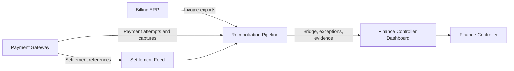
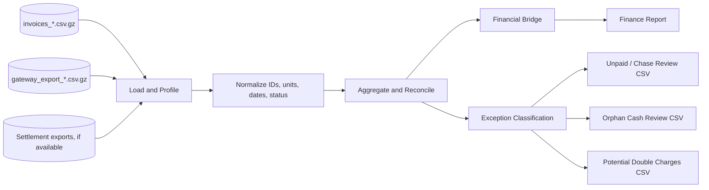
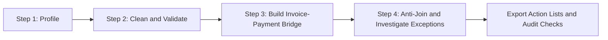
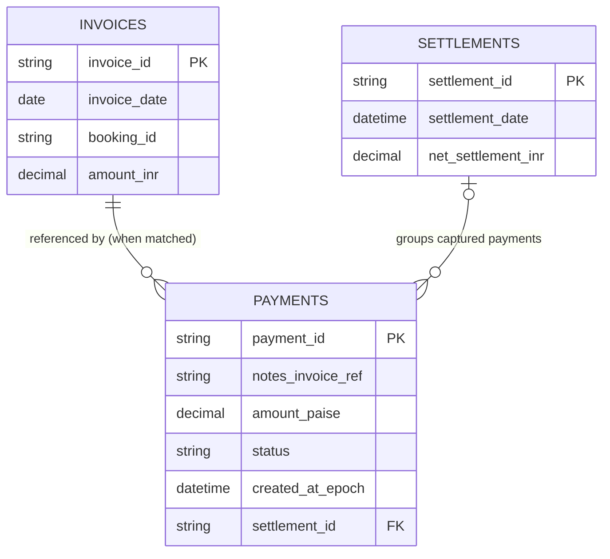
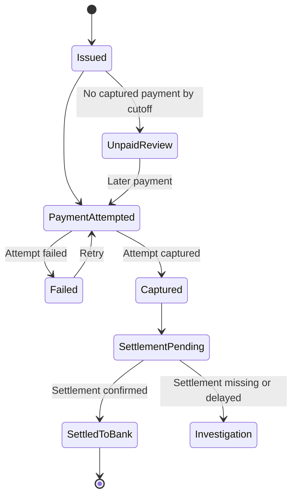
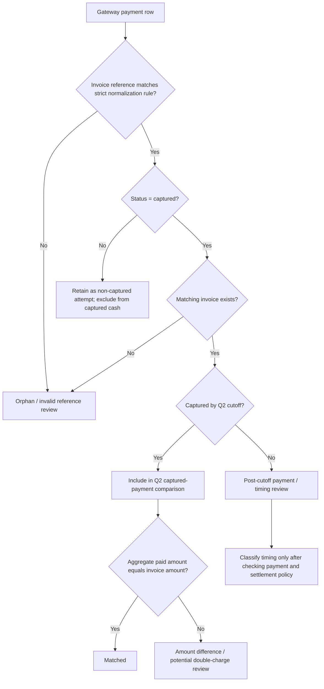
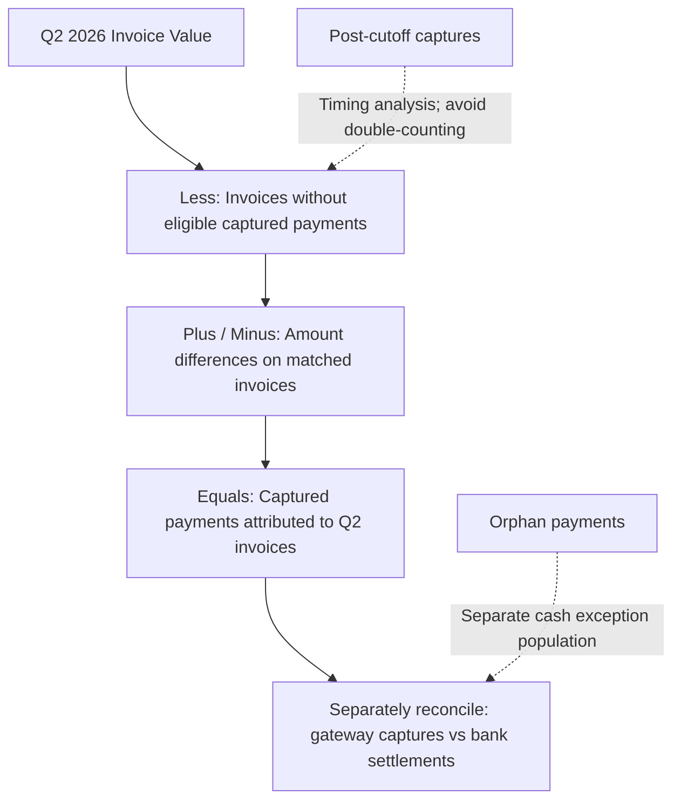
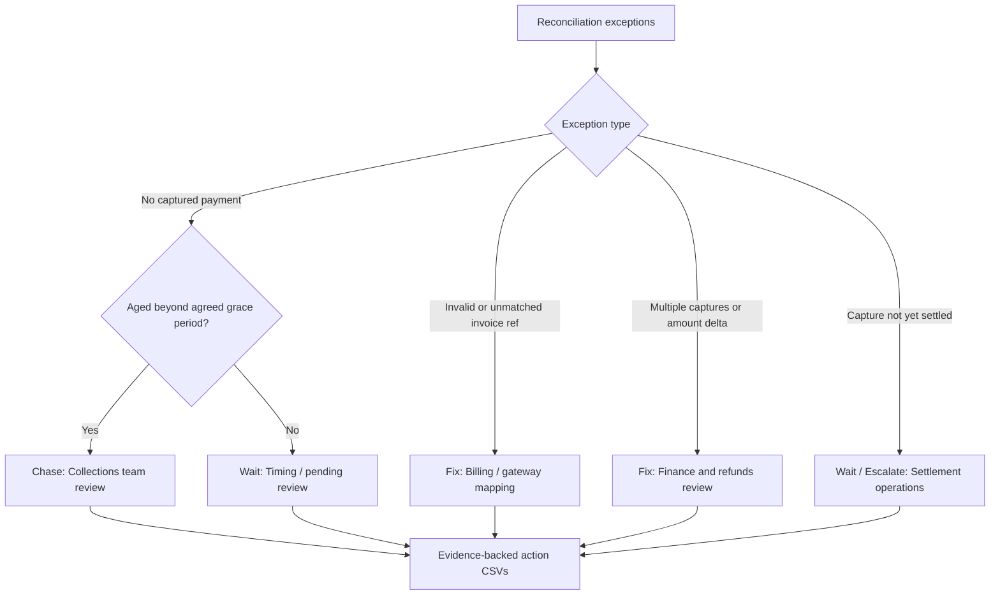
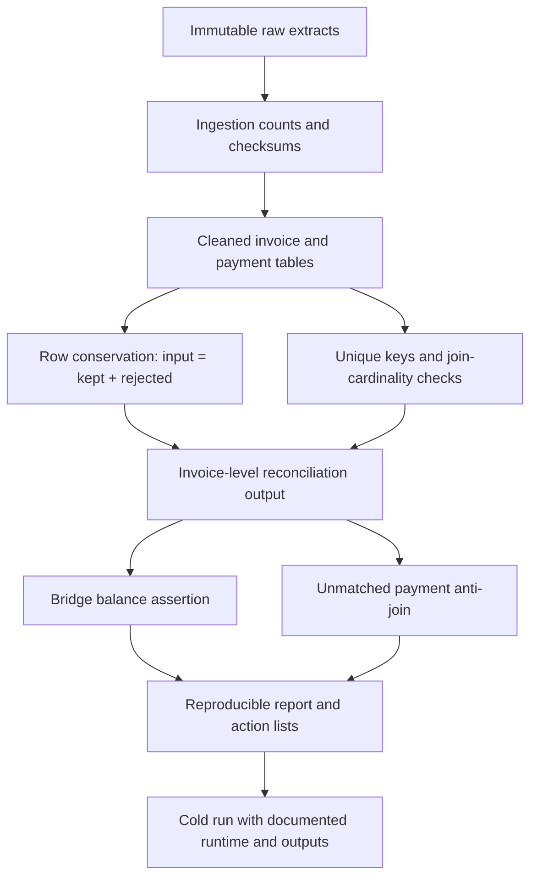

# Architecture & Reconciliation Diagrams — Brief C (Money)

**Project:** Kalpa Health — Group 4  
**Purpose:** Nine Mermaid diagrams describing the billing-to-payment reconciliation design, decision rules, and audit controls.

> **Interpretation note:** These diagrams represent the proposed analytical design, not proof that every component or classification rule is implemented. The cutoff, settlement handling, and exception categories must be validated against source data and finance policy.

## 1. System Context

## 2. Data Context

## 3. High-Level Design

## 4. Entity Model

**Cardinality caveat:** A payment may have no valid invoice match; a settlement ID may be absent or pending. The entity diagram models the *intended reference relationship*, not a guaranteed foreign-key constraint. Settlement fields shown are illustrative and must be checked against the actual settlement export schema.

## 5. The Life of an Invoice

## 6. Decision Flow for Matching

## 7. Financial Reconciliation Bridge

**Bridge rule:** Use mutually exclusive categories and exact amounts. A post-cutoff capture cannot be simultaneously counted as a permanent unpaid loss. Orphan payments are not automatically attributable to Q2 invoices.

## 8. Exception Triage and Action Ownership

**Policy caveat:** The seven-day timing rule described in the project approach log is a working heuristic, not proof that all younger unpaid invoices are settlement float. Confirm it against contractual payment terms and observed post-cutoff receipts.

## 9. Audit Trail and Cold-Run Validation

## Review checklist

- [ ] Confirm exact input filenames, schemas, and row counts.
- [ ] Verify invoice ID normalization against real gateway references.
- [ ] Confirm whether payment cutoff uses UTC or IST and document the rule.
- [ ] Keep payment captures separate from settlement deposits and fees.
- [ ] Validate exception classification against payment terms and refunds.
- [ ] Confirm that each bridge component is mutually exclusive and balances exactly.
- [ ] Ensure every action-list row traces to original invoice and/or payment IDs.
